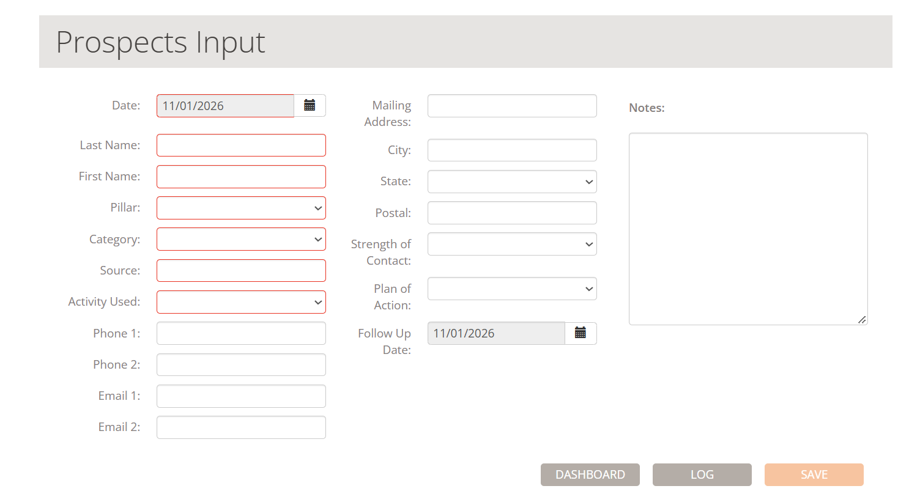

# Logsperity pilot feedback

*Collected November 2, 2026.*

## General

- If someone does not have Siri turned on, can we notify them to turn it on?
- Can we use this logo in the app/icon? A white arrowhead is centered on a blue circle, symbolizing a target or focus.

  *(Logo image not included in this file.)*

### Universal terminology

This app will work for all solopreneurs. Need to change loan-specific language to generic language (i.e. loan amount needs to be transaction size). We could set up industry-specific categories and activities (real estate/legal/therapy/construction/etc.). Right now, Logsperity is real estate heavy, which is great for realtors and loan officers but not therapists or attorneys.

### Coaching — changing the order of pillars

Business comes from 4 pillars — clients, relationships, advertising, and prospecting — but from a coaching perspective it is not good to have an acronym of CRAP. Can we switch the order to prospects, advertising, relationships, and clients (**PARC**)? From a coaching perspective, a new person will start with prospecting and advertising, and their business will mature into a more relationship- and client-based business.

### Hint

I think it is a good idea to create a "Hint" feature. This is a partial entry. Solopreneurs are on the run, so they may not stop to log an entry. A hint could help them get some basic information into one of the logs and complete it at the end of the day (or another later time).

For example, a past client refers their friend. The solopreneur doesn't have all the vital information yet, but they don't want to forget to log it. A hint will be a partially entered log that Herb will clean up later. The same thing could happen if Herb asks about an expense (triggered by a banking app) or a trip (triggered by GPS).

### Gamification

I created a thing called the Logsperity Index to gamify the app. I think there are other ways to do this, such as prizes (advanced coaching tips or vendor discounts) and badges for logging. Or we can play around with this.

### Big money idea

Evan thinks we should start with a small price point. We could start with $5–10/month. But we can also make money from advertising and affiliate marketing. For example, the coach suggests a website like Yelp or a printing vendor. Those vendors could place an ad connected to the suggestion and/or we make money when they click through to the service.

## Logs

- Strength of contacts need colors (red, orange, yellow, blue, black).
- Are we able to have 2 first-name spots for couples?
- Please change "Networking Open Group" and "Networking Closed Group" to just "Networking".
- For the analytics and coaching to work, users have to input the items in red. If a user is on the run, they can set up a hint that can be converted to a full entry later. I think we could get Herb to input Pillar, Category, and Activity Used from commonly used Sources.

  

### Prospects

- In Prospects, if one hits Save and Next, can all the fields other than date be blank?
- Can we have a + feature to add others as a group (many people are completing transactions together)?
- Please add "Text", "Video Message", and "Social Media Message" to the prospect plan of action list.
- Since we can now export data to CRMs, please take out these follow-up activities: "Email Campaign", "Phone Campaign", and "Mail Campaign".

### Closings

- When searching the prospects list, can the names be in alphabetical order?

### Income

- Seems to be working well so far.

### Expenses

- This log starts with the "General" category selected. Can it be blank?
- In the Vendor field, can we make all words capitalized?
- Can we hit a toggle switch to indicate an expense is recurring? Can we have Herb verify at the beginning of the month that the subscriptions/charges are still valid for the upcoming month?
- Can we link Logsperity to banking and credit card apps, so it can ask a user which expenses are business related?
- If an account is 100% business, can it automatically log the expenses?

### Mileage

- IRS mileage rate is now $0.725/mile.
- Let's change Reason to a field with suggestions below based on previous entries.
- Can we incorporate a GPS feature? When someone starts to drive during business hours, can Herb pop up, ask if it is a business trip, and create a hint?

### Activity

- Can we make the log reflect 0.25 hours (it is rounding to 0.3 or 0.8)?
- Please take out "Lead Generation".
- Please add "Social Media Content Creation", "Social Media Interaction", and "Livestreaming".
- Please take out "Facebook Marketing" and "Twitter Interaction", replacing them with the items above.

## Coaching

I will dig into this more, but this is pretty amazing from what I can see.

---

## Status — build 0.1.0 (5)

**Done in build 5**

| Feedback | What changed |
|---|---|
| Siri not turned on | HERB's voice needs Dictation, not Siri. If voice isn't available, HERB now says exactly where to turn it on (Settings → General → Keyboard → Enable Dictation). |
| Logo / icon | New bold target-and-arrows icon (build 4). |
| Loan-specific language | HERB now says "transaction size" and "deal" instead of "loan amount" and "loan". |
| PARC order | Pillars show as Prospecting, Advertising, Relationships, Clients everywhere (pickers, reports, cheat sheet). |
| Hint | Any prospect, expense or trip can be saved with what you have: Save turns into **Save as hint**. It waits in the Review queue, and HERB asks for the missing fields later. |
| Strength colors | Red Hot = red, Hot = orange, Medium = yellow, Cold = blue, No Go = black, shown in the Prospects list and picker. |
| Couples | New "Second first name (couples)" field; saved as "Tom & Ana". |
| Networking | "Networking-Open Group" and "Networking-Closed Group" (and the "Network-Open Group" category) are now just "Networking". Existing entries move over automatically. |
| Required fields in red | The prospect form follows the Prospects Input screen: date, last name, first name, pillar, category, source and activity used first, in red until filled in. Phone 2, Email 2, city and state added. |
| HERB fills in from Sources | Picking a source you've used before fills in its usual pillar, category and activity (only empty fields; you can change them). |
| Save & Next | Clears every field except the date. |
| Plan of action | Added Text, Video Message, Social Media Message. Removed Email, Phone and Mail Campaign. |
| Closings — prospect list | Alphabetical by last name ("Becker, Tom & Ana"). |
| Expenses — blank category | A new expense starts with no group or category chosen. |
| Vendor capitalization | Each word is capitalized as you type and on save ("Cedar Grill"). |
| Recurring expenses | New "Recurring monthly charge" toggle. At the start of each month, Today shows **Monthly charges** — tap Log to add this month's charge or Stopped to stop asking. |
| IRS mileage rate | $0.725/mile for all of 2026. |
| Mileage reason | Free-text field with suggestions from your past trips (most used first), then the standard list. |
| Activity quarter hours | Activity times show to the quarter hour (1.25 h, 0.75 h). |
| Activity list | Removed Lead Generation, Facebook Marketing and Twitter Marketing. Added Social Media Content Creation, Social Media Interaction and Livestreaming (under Clients and Advertising – Internet). Existing entries move over automatically. |

**Next — needs a decision or an outside service**

| Feedback | What it needs |
|---|---|
| Industry-specific categories and activities (realtor, legal, therapy, construction) | Agreement on each industry's lists; then a profession choice at setup picks the list. |
| Add several people as a group on one prospect | A "group" link between prospects and how closings and income split across them. |
| Link bank and credit card accounts; auto-log 100%-business accounts | A bank-data provider (for example Plaid), a small server to hold the connection, and its monthly cost. |
| GPS: ask "Is this a business trip?" when driving during business hours | Location permission ("Always"), battery testing, and a privacy policy update. |
| Gamification (prizes, badges) | Which rewards to offer and who provides them. |
| Pricing and advertising/affiliate income | Business decision; In-App Purchase is set up before the App Store release. |
